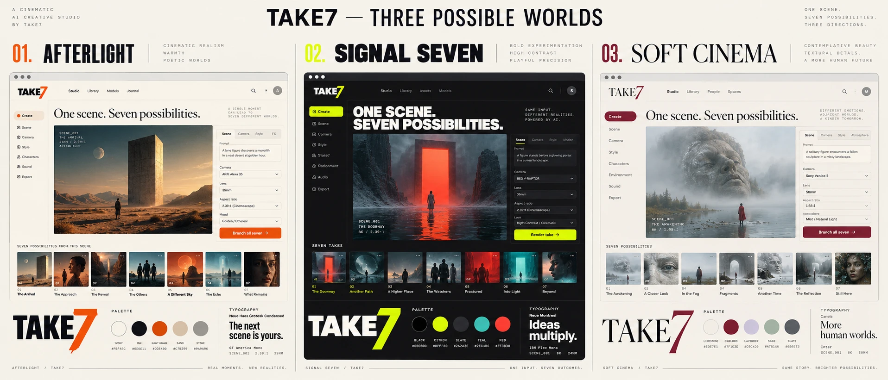

# TAKE7: brand explorations

**Positioning:** a director’s decision room for discovering seven emotional readings of one scene.

**Name:** TAKE7. Read “take seven.” The numeral is a product mechanic, not a decoration: Wonder, After hours, Fever dream, Wild card, Quiet tension, Yesterday, and Another world.

**Signature:** One scene. Seven ways to feel it.

## 01 — Afterlight

A warm editorial cinema journal. Ink-black canvas, parchment typography, burnt-orange accents, photographic stills, generous margins, and small technical captions. Headlines feel like film titles. Interactions should be slow and quiet. Best for an intimate auteur mood; less immediately playful in social clips.

Palette: `#171715` ink, `#EDE8DD` paper, `#D59465` amber, `#8C9685` sage.

## 02 — Signal Seven — recommended direction, pending owner choice

A contemporary production instrument with editorial warmth. Near-black panels, warm-white headings, one sharp chartreuse signal color, and seven subdued treatment colors. Use an oversized 7, fine rules, compact technical metadata, big image surfaces, and high-contrast controls. Let color identify intent and state; reserve the bright signal for the primary action or active focus.

Palette: `#111311` canvas, `#1B1E1A` surface, `#F1F1E8` text, `#D8EF72` signal, `#92978A` muted. Use a clean sans-serif for the interface and tabular numerals for seed, lens, and timing. The icon system is Hugeicons; accessible interaction primitives are Base UI.

The central branded interaction is **Explore seven**: one concept visibly opens into seven decisions. A future demo should make that moment instantly understandable within five seconds.

## 03 — Soft Cinema

A light creative desk: cream paper, lilac notes, cobalt controls, rounded cards, contact-sheet grids, and generous negative space. Approachable for first-time creators; friendly in educational content. Keep the image preview dark enough to judge contrast.

Palette: `#F4F0E9` paper, `#FFFFFF` card, `#24232A` ink, `#C8B8E7` lilac, `#555CE6` cobalt.

## Shared design rules

- Write like a helpful director: “Try a quieter frame,” “Keep this take,” “Explore seven.” Avoid unsupported claims about perfect identity or camera control.
- Always distinguish a planning preview from a generated image/video.
- Keep advanced settings readable and reversible. Preserve the scene while changing a direction.
- Show credit-related actions as intentional render requests; branching is planning, not an automatic batch charge.
- Pair hover behavior with keyboard focus, honor reduced motion, label icon-only buttons, and keep text contrast legible.
- Use the seven treatments as expressive accents rather than seven competing primary colors.

These are three art directions, not a claim that all three themes have shipped. The implemented interface and screenshots should be reviewed against the chosen direction before finalizing the brand.

## Concept board

[View the three-direction concept board](../public/brand/directions.webp).

This generated concept board is visual exploration, not a screenshot of three implemented themes. The [portal artwork](../public/brand/doorway.webp) is a separately generated fictional preview, not a Comfy render. Neither asset is evidence of open-weights generation; see [provenance](../THIRD_PARTY.md).

## Implemented studio themes

Signal Seven is the default, as selected by the user. The Visual theme control switches the entire studio to Afterlight or Soft Cinema and remembers the choice on the device. The `/brand` route provides identity specimens and a “Try in the studio” action for each direction. Changing a theme never changes the project or generation recipe.
